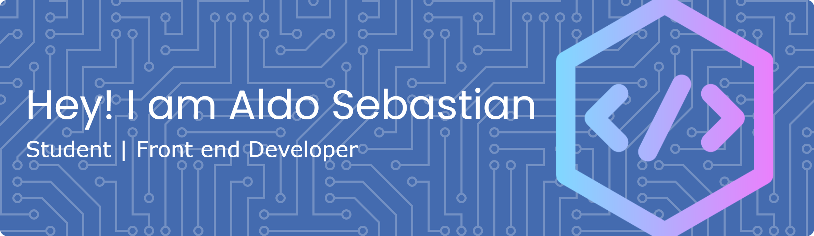

  

 

Frontend engineer and UI/UX designer in Medan, Indonesia. I build web and mobile products in TypeScript, Next.js and Flutter, from the Figma file to the deployed release.

## About

I take the interface layer end to end: typed components, validated forms, automated tests, and the CI that runs them. Layouts have to hold up on a 390px screen, and specs have to live in the repo.

Currently learning Postgres and API design to add backend depth to the interface work.

## Stack

**Interface**     

**Mobile**   

**Design and delivery**     

**Also used:** Python, Riverpod, GoRouter, npm

## Selected work

**[Jaecoo Medan Sales Executive Portal](https://github.com/aldosebastian1/jaecoo-sales-executive-web)** Next.js 16, React 19, TypeScript, Tailwind CSS v4

Vehicle catalogue, test-drive booking and dealer locator for a Jaecoo dealership. Server components, Zod-validated forms, GA4 conversion tracking and JSON-LD dealer schema.

**[Hondaku](https://github.com/aldosebastian1/Aplikasi-Mobile-Hondaku)** Flutter, Dart, Firebase Authentication, flutter_secure_storage

Motorcycle dealership app: catalogue, real-time credit simulation and end-to-end booking. Session tokens in hardware-backed storage, tests covering the booking, catalogue and responsive layout flows.

**[Aura Dermacare](https://aura-dermacare.vercel.app)** [repo](https://github.com/aldosebastian1/Aura-Dermacare) React, TypeScript, Vite, Vercel

Clinic website for a dermatology practice serving Jakarta and Medan. React and TypeScript, deployed on Vercel.

**[ProjectKu](https://github.com/aldosebastian1/projectku-app)** Flutter, Riverpod, GoRouter, Cloud Firestore

Freelance workspace tracker: wallet-style dashboard for paid and outstanding invoices, deadline-aware progress timeline and real-time sync across devices. Bilingual Indonesian and English.

## Engineering practice

- **CI on push:** `npm ci`, strict type-check and ESLint on the Jaecoo portal; `flutter analyze` and `flutter test` on Hondaku.
- **Tests before merge:** 8 test files covering Hondaku's booking, catalogue and responsive layout flows.
- **Specs kept in the repo:** product requirements doc for the Jaecoo portal; architecture, UI and case-study docs for ProjectKu.

## Activity

## Contact

Open to internships and freelance work in frontend, mobile and product design.

  

